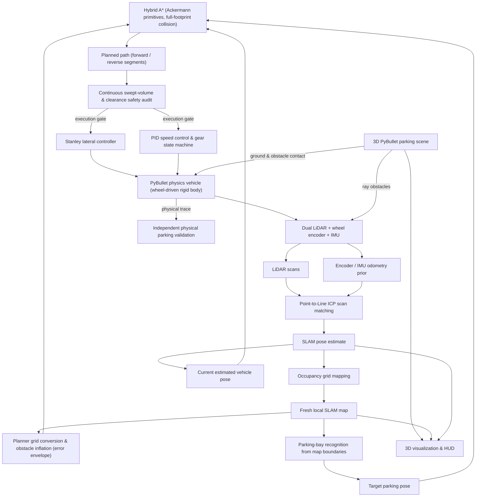
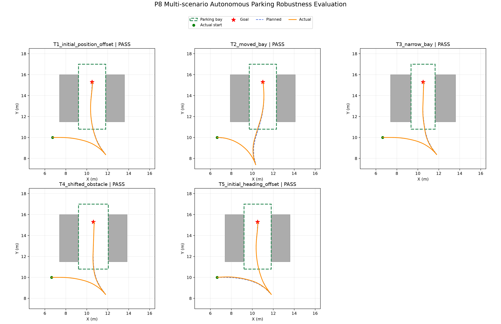

# AutoMotion-SLAMPark

### SLAM-Driven Autonomous Parking with Hybrid A\* and Physics-Based Vehicle Simulation

**Final status: `COMPLETE_PARKING_PASS`** — a four-wheel, physics-driven vehicle observes the lot with dual simulated LiDARs, builds a fresh local occupancy map, recognizes the parking bay from that map, replans with Hybrid A\*, and completes a full reverse park in PyBullet with zero collisions.


*P11.7.9 final acceptance — left: fresh local SLAM map with the Hybrid A\* plan; middle: planned path vs. actual physical trajectory with full-footprint containment checks; right: final parked state in PyBullet; bottom: speed / steering / tracking-error traces over the 75 s physical run.*

AutoMotion-SLAMPark is a modular autonomous parking system built with Python and PyBullet. It progresses from 2D parking algorithms (kinematics, Hybrid A\*, closed-loop control) to 2D LiDAR-SLAM navigation, and finally to a 3D physics-based parking system. Unlike demonstrations that only draw geometric trajectories, this project closes the loop with a rigid-body vehicle driven through wheel motors, steering joints and brakes — localization and planning consume simulated sensor measurements only, never ground-truth poses.

## Three Core Achievements

### 1. Algorithm capability — planning, estimation and control implemented from scratch

- **Hybrid A\*** with forward/reverse motion primitives, steering constraints, direction-switch and steering costs, heading-aware heuristic, and full-vehicle-footprint collision checking.
- **Point-to-Line ICP** scan-to-map matching with robust loss and odometry prior; quality-gated acceptance with odometry fallback (43/43 pair tests passed).
- **Incremental Occupancy Grid SLAM** (online and fresh-local variants) fusing dual LiDAR, wheel encoder and IMU.
- **Direction-aware Stanley** lateral control, **PID** signed-speed control, and a stop-before-shift **gear state machine**; Stanley vs. Pure Pursuit comparison included.
- Curvature-constrained speed profiling and adaptive steering feedback for smoother low-speed maneuvers.

### 2. Engineering capability — from 2D algorithms to a 3D physics vehicle in one integrated system

- Layered package: `vehicle / planning / control / sensing / localization / mapping / slam / integration / simulation`, with one reproducible entry script per development stage.
- 1,176 kg PyBullet vehicle: rigid chassis, steerable front wheels, rear-wheel drive motors, per-wheel braking, 240 Hz physics — motion is produced by tire contact forces, never by pose resets.
- End-to-end pipeline integration: sensor → matching → mapping → bay recognition → planning → safety audit → control → physical execution → independent validation.
- Every stage persists its artifacts (NPZ trajectories/maps, JSON metrics, Markdown reports, PNG figures) so any experiment can be re-audited; SHA256 checks protect passed-stage outputs.

### 3. Validation capability — reliability proven by sensors, envelopes and independent audit

- **Dual LiDAR** (front + rear, 720 beams / 270° each) plus a roof-mounted rear sensor to remove the near-field blind zone; no self-hits across thousands of rays.
- **Fresh Local SLAM**: the final run starts from a new local origin and builds its map from scratch — no historical map, no recorded trajectory, no hardcoded goal.
- **Full-footprint and swept-volume collision checking** with a measured error envelope (0.13 m) and continuous clearance lower bound (0.30 m) between discrete path samples.
- Safety gates that *refuse* to plan when the map is uncertain (P11.7.1–P11.7.8 failure records kept as-is, never relabeled as PASS).
- Independent post-run physical audit: final pose error, bay containment of the complete body, collision counts, stop-and-hold verification.

## System Pipeline



## Technology Stack

| Area | Technologies |
|---|---|
| Language / environment | Python 3.13, Anaconda, Git |
| Physics simulation | PyBullet (240 Hz, rigid body, joints, motors, contact), pybullet_data |
| Planning | Hybrid A\*, motion primitives, heading-aware heuristic, curvature-constrained speed profile, Reeds-Shepp-style forward/reverse search |
| Localization & mapping | 2D / dual LiDAR, ICP, Point-to-Line ICP, scan-to-map matching, incremental Occupancy Grid, online SLAM, Fresh Local SLAM, wheel odometry, IMU heading |
| Control | Stanley, Pure Pursuit, PID, adaptive steering, gear-management state machine |
| Safety | Footprint collision checking, swept-volume checking, geometric clearance, error envelopes, runtime safety supervision |
| Numerics & evaluation | NumPy, SciPy, Matplotlib, NPZ/JSON/CSV artifacts, trajectory and collision audits |

## Experimental Results

| Stage | Achievement |
|---|---|
| P0–P4 | Ackermann kinematics, Hybrid A\*, Stanley/PID closed-loop parking (final error 0.049 m / 0.36°, 0 collisions) |
| P5–P8 | Multi-scenario tests 3/3, controller comparison, optimization, robustness 5/5 PASS |
| P9 | LiDAR simulation, ICP 43/43, incremental and online SLAM |
| P10 | Planning on SLAM maps, online localization feedback, full autonomous parking closed loop |
| P11.1–P11.5 | 3D PyBullet scene, physics vehicle, full three-segment physical parking PASS |
| P11.6 | Physical-vehicle LiDAR exploration with live SLAM |
| P11.7.9 | Fresh Local SLAM → bay recognition → replan → physical reverse park: **COMPLETE_PARKING_PASS** |

### Final P11.7.9 acceptance metrics

| Metric | Result | Requirement | |
|---|---:|---|---|
| Final position error | 0.0733 m | ≤ 0.10 m | PASS |
| Final heading error | 0.0283° | ≤ 2° | PASS |
| Final actual speed | 9.2e-6 m/s | ≤ 0.01 m/s | PASS |
| Max online localization error | 0.0322 m | 0.08 m budget | PASS |
| Max trajectory-to-reference distance | 0.0049 m | ≤ 0.10 m | PASS |
| Body contained in original / map-recognized bay | True / True | True | PASS |
| PyBullet collisions / independent overlap samples | 0 / 0 | 0 | PASS |
| Stop-and-hold duration | ≥ 2 s | ≥ 2 s | PASS |
| Final gear | reverse | reverse | PASS |
| Pose resets / external forces | 0 / 0 | 0 | PASS |

## Key Result Figures

**2D closed-loop parking (P4, kinematic)**


**Controller comparison (P6, Stanley vs Pure Pursuit)**


**Robustness under five perturbation classes (P8, 5/5 PASS)**



**Incremental LiDAR SLAM map (P9.5.3)**


**Hybrid A\* planned on the SLAM map (P10.1)**


**Full closed-loop parking under online SLAM feedback (P10.3)**


**3D PyBullet scene and physics vehicle (P11.1)**


**Complete physical parking with wheel-driven execution (P11.5)**


**Live SLAM map while the physical vehicle drives (P11.6.4)**


## Project Structure

```text
AutoMotion-SLAMPark/
├── configs/                # parking scenario: bay, obstacles, vehicle geometry
├── parking_planner/
│   ├── vehicle/            # Ackermann kinematics / dynamic model
│   ├── planning/           # Hybrid A*, path utils, bay recognition, robust clearance
│   ├── control/            # Stanley, Pure Pursuit, PID speed, gear state machine
│   ├── sensing/            # 2D/dual LiDAR, encoder+IMU, PyBullet ray sensors
│   ├── localization/       # ICP / Point-to-Line ICP scan matching
│   ├── mapping/            # occupancy grid updates
│   ├── slam/               # online SLAM and Fresh Local SLAM
│   ├── integration/        # SLAM-map-to-planner adapter
│   └── simulation/         # kinematic closed loop + PyBullet scene/vehicle/executors/HUD
├── scripts/                # one reproducible entry per stage (run_p*.py)
├── results/                # selected metrics, reports and figures
└── README.md
```

## Setup & Reproduce

```bash
conda create -n parkingplanner python=3.13 numpy scipy matplotlib -y
conda activate parkingplanner
pip install pybullet pybullet_data
```

Run from the repository root (kinematic stages do not need PyBullet):

```bash
python -m scripts.run_parking_scenario        # P3: reference parking path
python -m scripts.run_closed_loop_parking     # P4: closed-loop control
python -m scripts.run_p8_robustness_tests     # P8: five-scenario robustness
python -m scripts.run_p9_5_2_online_slam      # P9: sequential online SLAM
python -m scripts.run_p10_3_full_autonomous_parking   # P10: SLAM-feedback parking

# P11.7.9: final full autonomous parking (fresh SLAM -> bay recognition -> replan -> physical reverse park)
python scripts/run_p11_7_9_fresh_local_parking.py --gui --demo --fast --no-map-window --output-dir results/p11_7_9/new_run
```

Interactive mode (`--gui --hold`): W/S speed, A/D steer, C center, SPACE brake; P stops and plans, click body center then heading in the map window and press ENTER; A executes; R returns to exploration, Q/ESC emergency stop. Existing metric files are never overwritten — use a fresh `--output-dir`.

## Scope & Limitations

- All validation is in PyBullet simulation; no real-vehicle or robot testing.
- LiDAR / encoder / IMU are simulated sensors; the vehicle uses a simplified tire and chassis model without real calibration.
- SLAM is local 2D occupancy-grid with Point-to-Line ICP; no global loop closure.
- Mapping exploration includes manual/interactive driving, not autonomous frontier exploration.
- The 0.2776 m continuous-clearance margin is an engineering probabilistic budget, not a formal deterministic safety certificate.

## 中文简介

AutoMotion-SLAMPark 是一个面向垂直车位倒车入库的自主泊车仿真系统：从 Ackermann 车辆运动学与自研 Hybrid A* 起步，集成方向感知 Stanley/PID 闭环控制与挡位状态机、双向 LiDAR + Point-to-Line ICP 增量式 SLAM、PyBullet 1176 kg 刚体物理车辆，最终在全新局部地图上完成车位识别、现场重规划与物理倒车入库的完整闭环。最终验收 P11.7.9 达到位置误差 0.0733 m、航向误差 0.0283°、零碰撞、完整车身入库并停车保持 ≥ 2 s（`COMPLETE_PARKING_PASS`）。

## Reference

- [AtsushiSakai/PythonRobotics](https://github.com/AtsushiSakai/PythonRobotics) — algorithm reading reference (not vendored in this repository).
