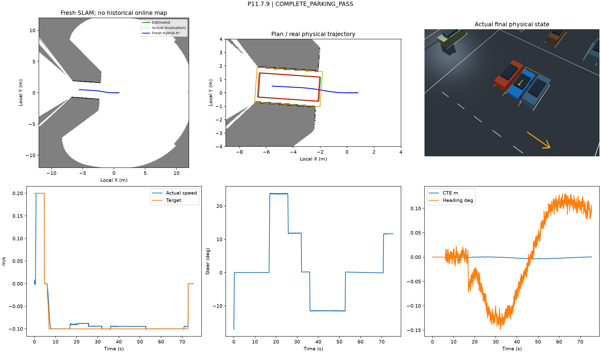
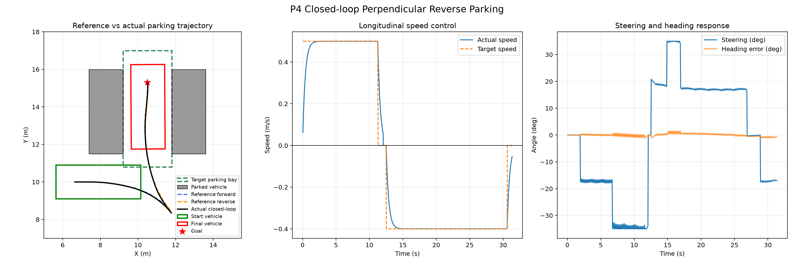
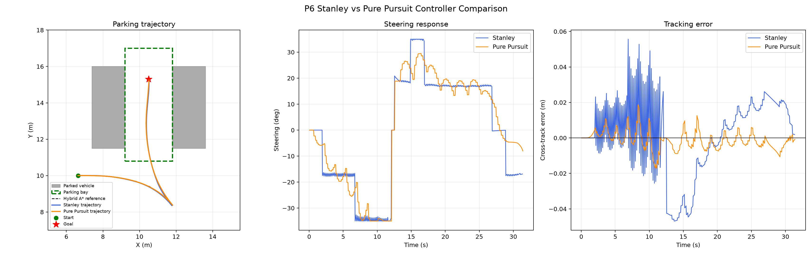
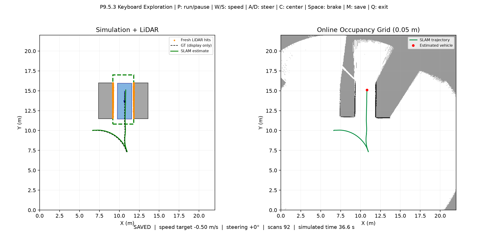
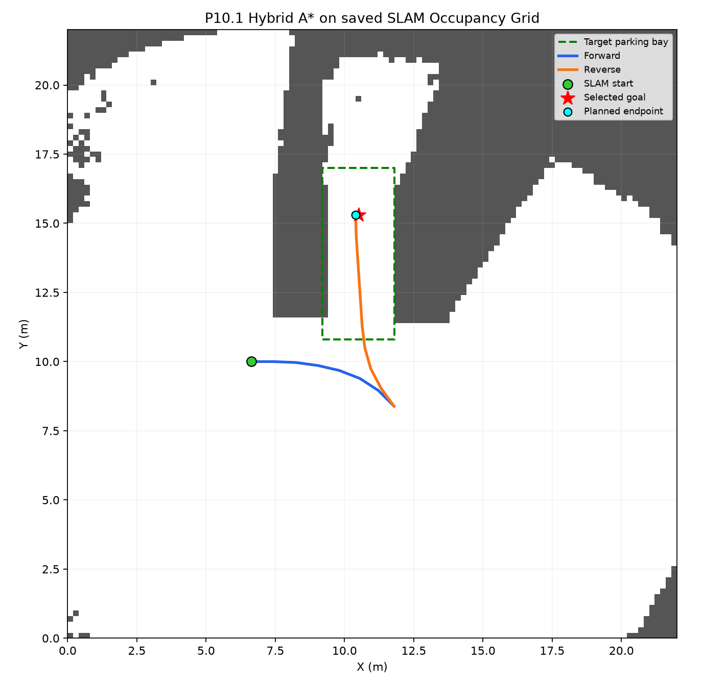
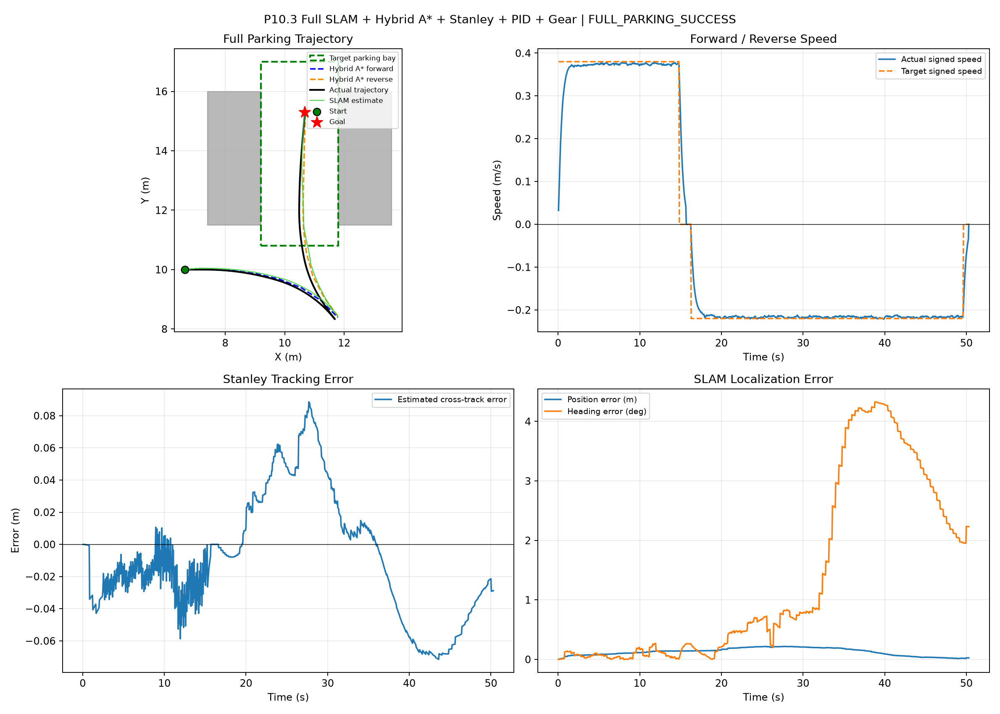
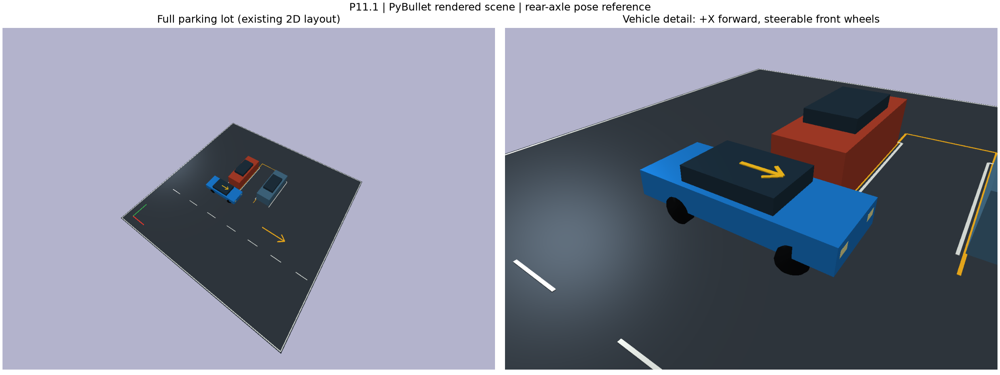
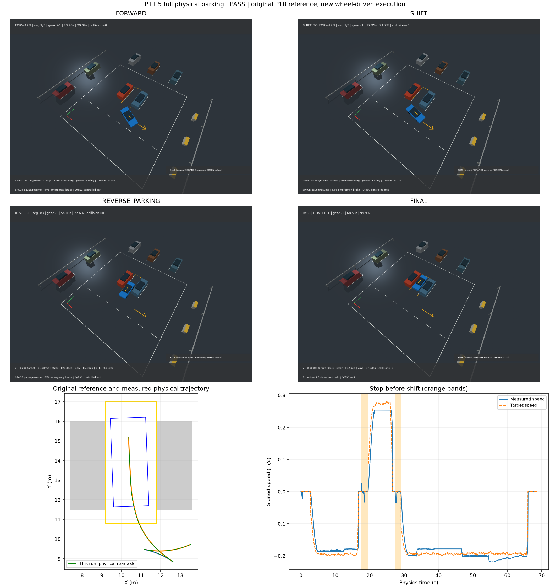
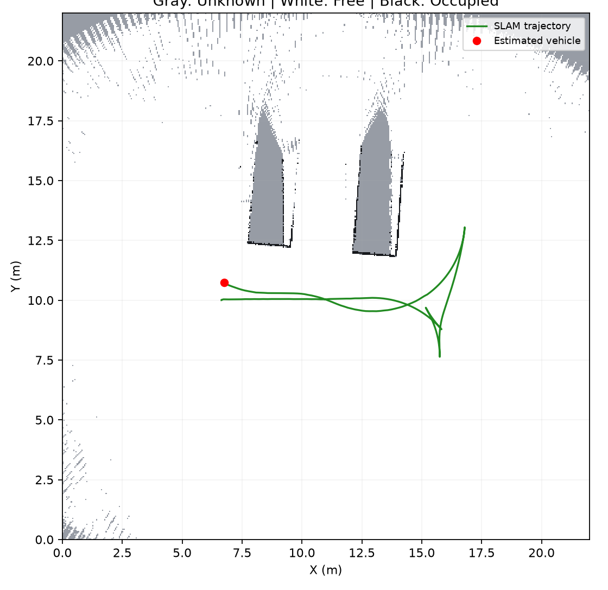

# AutoMotion-SLAMPark (ParkingPlanner)

面向垂直车位倒车入库的自主泊车仿真系统：从 Ackermann 车辆运动学与 Hybrid A* 路径规划起步，逐步集成方向感知 Stanley/PID 闭环控制、双向 LiDAR + Point-to-Line ICP 增量式 SLAM、PyBullet 刚体动力学车辆，最终在**全新局部地图**上完成车位识别、现场重规划与物理倒车入库的完整闭环。

最终验收（P11.7.9）状态：`COMPLETE_PARKING_PASS`。

> 说明：本项目中的"物理车辆"指 PyBullet 刚体动力学车辆，LiDAR/IMU/编码器为仿真传感器；Ground Truth 仅用于仿真物理与离线评估，不进入在线规划与控制。

## 最终验收结果（P11.7.9）

| 验收项 | 实测值 | 要求 | 结果 |
|---|---:|---|---|
| 最终位置误差 | 0.0733 m | ≤ 0.10 m | PASS |
| 最终航向误差 | 0.0283° | ≤ 2° | PASS |
| 最终速度 | 9.2e-6 m/s | ≤ 0.01 m/s | PASS |
| 原始车位 / 新地图识别车位完整车身包含 | True / True | True | PASS |
| 最后运动挡位 | 倒车 | 倒车 | PASS |
| 停车保持 | ≥ 2 s | ≥ 2 s | PASS |
| PyBullet 碰撞 / 独立几何重叠 | 0 / 0 | 0 | PASS |
| 最大在线定位误差 | 0.0322 m | 工程预算 0.08 m | PASS |
| 轨迹-参考折线最大偏差 | 0.0049 m | ≤ 0.10 m | PASS |



左：全新局部 SLAM 地图与 Hybrid A* 规划；中：规划路径与实际物理轨迹、完整车身包含检查；右：PyBullet 中最终入库状态；下排：速度/转向/跟踪误差过程曲线。

## 系统流水线

| 层级 | 核心模块 | 作用 |
|---|---|---|
| 环境与车辆 | `simulation/pybullet/scene.py`、`physics_vehicle.py` | 三维停车场、1176 kg Ackermann 物理车辆（轮端驱动/转向/制动） |
| 感知 | `sensing/dual_lidar.py`、`encoder_imu.py` | 前后双向 720 束 LiDAR、编码器+IMU 局部运动先验 |
| 定位建图 | `slam/online_slam.py`、`fresh_local_slam.py`、`localization/point_to_line_icp.py` | Point-to-Line ICP 扫描配准、质量门限与里程计回退、增量式 Occupancy Grid |
| 车位识别 | `planning/local_bay.py` | 从新地图 occupied 长直线边界对识别车位中心/宽度/深度 |
| 规划 | `planning/hybrid_astar.py`、`robust_clearance.py` | 运动学约束搜索、完整车身碰撞、误差包络与连续净空检查 |
| 控制 | `control/stanley_controller.py`、`speed_controller.py`、`gear_manager.py` | 方向感知 Stanley 横向控制、PID 速度控制、停止后换挡状态机 |
| 执行与验收 | `simulation/pybullet/full_parking_executor.py`、`scripts/run_p11_7_9_fresh_local_parking.py` | 物理闭环执行与独立安全审计 |

## 关键结果图

**二维闭环泊车（P4，运动学闭环）**



**控制器对比（P6，Stanley vs Pure Pursuit）**



**增量式 SLAM 建图（P9.5.3）**



**SLAM 地图上的 Hybrid A* 规划（P10.1）**



**在线 SLAM 反馈下的完整闭环泊车（P10.3）**



**PyBullet 三维场景与物理车辆（P11.1）**



**物理车辆完整泊车（P11.5，三段轨迹物理执行）**



**物理驾驶中的实时 SLAM 地图（P11.6.4）**



## 仓库结构

```text
configs/                 垂直泊车场景统一配置（车位、障碍物、车辆几何）
parking_planner/
  vehicle/               Ackermann 运动学模型
  planning/              Hybrid A*、路径工具、车位识别、鲁棒净空
  control/               Stanley / Pure Pursuit / PID 速度 / 挡位状态机
  localization/          Point-to-Line ICP 等扫描配准
  mapping/               Occupancy Grid 更新
  slam/                  在线 SLAM 与全新局部 SLAM
  sensing/               2D/双向 LiDAR、编码器+IMU、PyBullet 射线传感
  integration/           SLAM 地图到规划栅格的适配
  simulation/            运动学闭环仿真 + PyBullet 物理场景/车辆/执行器/HUD
scripts/                 各阶段实验入口（run_p*.py，按阶段编号）
results/                 精选指标 JSON、Markdown 报告与结果图
```

## 环境安装

```bash
conda create -n parkingplanner python=3.13 numpy scipy matplotlib -y
conda activate parkingplanner
pip install pybullet pybullet_data
```

## 运行

在项目根目录执行（运动学阶段无需 PyBullet）：

```bash
# P3：生成垂直泊车参考路径
python -m scripts.run_parking_scenario

# P4：闭环控制执行
python -m scripts.run_closed_loop_parking

# P8：五场景鲁棒性测试
python -m scripts.run_p8_robustness_tests

# P9.5.2：顺序在线 SLAM
python -m scripts.run_p9_5_2_online_slam

# P10.3：在线 SLAM 反馈下的完整闭环泊车
python -m scripts.run_p10_3_full_autonomous_parking

# P11.7.9：最终完整自主泊车（新局部 SLAM → 车位识别 → 重规划 → 物理倒车入库）
python scripts/run_p11_7_9_fresh_local_parking.py --gui --demo --fast --no-map-window --output-dir results/p11_7_9/new_run
```

P11.7.9 交互模式（`--gui --hold`）：W/S 调速、A/D 转向、C 回正、SPACE 制动；P 停车并规划，在地图窗口依次点击车身中心与车头方向后 ENTER 确认；A 自动执行；R 返回探索，Q/ESC 急停。程序拒绝覆盖已有指标，复现时请指定新的 `--output-dir`。

## 阶段总览

| 阶段 | 内容 | 状态 |
|---|---|---|
| P0–P3 | Ackermann 模型、场景建模、自研 Hybrid A* | PASS |
| P4–P6 | Stanley/PID 闭环、多场景测试、控制器对比 | PASS |
| P7–P8 | Heading-aware 启发式、曲率速度规划、5 类扰动鲁棒性 | 5/5 PASS |
| P9 | LiDAR 仿真、Point-to-Line ICP、增量式 SLAM | 完成 |
| P10 | SLAM 地图规划、在线定位反馈、探索-选位-执行闭环 | 完成 |
| P11.1–P11.5 | PyBullet 三维场景、物理车辆、完整物理轨迹泊车 | PASS |
| P11.6 | 物理车辆 LiDAR 探索与实时 SLAM | 地图保存 |
| P11.7.1–P11.7.8 | 目标阻塞安全拒绝、误差包络、定位认证问题（失败留档） | 安全拒绝 |
| P11.7.9 | 新局部地图 + 车位识别 + 重规划 + 物理倒车入库 | COMPLETE_PARKING_PASS |

`scripts/run_p11_7_1` ~ `run_p11_7_8` 为安全门禁与问题定位阶段的诊断脚本，其失败记录按原样保留（未改标为 PASS），并被最终入口 `run_p11_7_9` 作为工具函数复用。

## 能力边界

- 全部验证在 PyBullet 仿真中完成，未在真实车辆/机器人上测试。
- PhysicsVehicle 为刚性底盘 + 简化轮胎摩擦模型，无悬架与实车标定。
- SLAM 为局部 2D Occupancy Grid + Point-to-Line ICP，无全局回环闭合。
- 建图探索包含人工/交互驾驶，不是自主 frontier exploration。
- 0.2776 m 连续净空裕度为工程概率预算，不是形式化安全证书。

## 参考

- [AtsushiSakai/PythonRobotics](https://github.com/AtsushiSakai/PythonRobotics)：算法阅读与对照参考（不随本仓库提交）。
